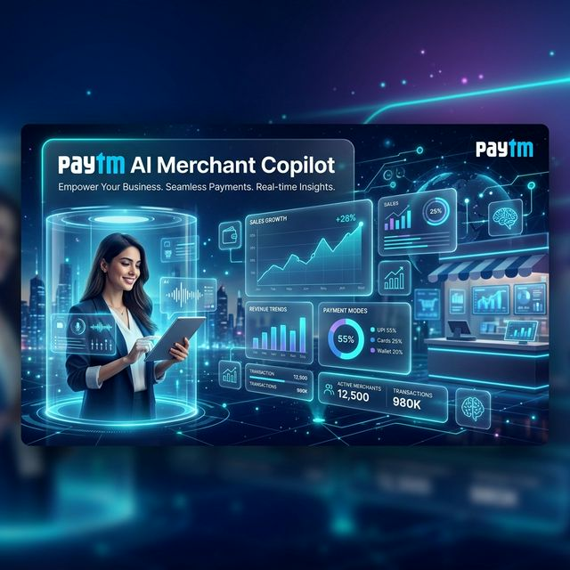
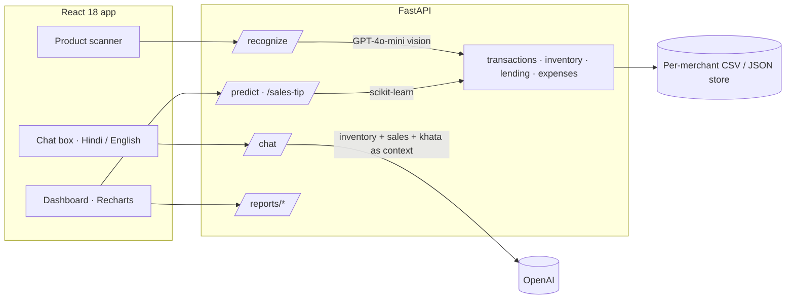

<div align="center">



# AI Merchant Copilot

**A shop assistant for India's small merchants: point the camera at a product, ask about your sales in Hindi or English, and see who owes you money.**

[](https://fastapi.tiangolo.com/)
[](https://react.dev/)
[](https://platform.openai.com/)
[](https://scikit-learn.org/)
[](https://recharts.org/)

[Features](#features) · [How it works](#how-it-works) · [Quick start](#quick-start) · [API](#api) · [3D showcase](SHOWCASE.html)

</div>

---

## The problem

A kirana store owner runs the whole business from memory and a paper notebook. They track stock by eye, write credit (*udhaar*) in a *khata*, and rarely know which products actually make money.
Most POS software is built for chains, not for a single counter with one phone.

## What it does

Merchant Copilot turns that phone into the back office:

| | |
|---|---|
| 📷 **Camera stock-in** | Take a photo of a product. GPT-4o-mini vision recognises the brand and variant (for example, *Kurkure Masala Munch*), matches it to your existing inventory and fills in the entry, so there is nothing to type. |
| 💬 **Ask your shop** | "How much did I sell yesterday?" "Who owes me money?" The assistant answers from your live inventory, recent sales and khata, **in Hindi (Devanagari) or English**. |
| 📒 **Digital khata** | Track credit per customer, see outstanding balances and settle a debt in one tap. |
| 📈 **Sales forecast** | A linear-regression model on daily sales predicts tomorrow's revenue, and the app suggests what to restock. |
| 🧾 **Reports** | Profit and loss, per-product margins, end-of-day summary, cash-drawer reconciliation and a daily notification digest. |
| 🔔 **Alerts** | Low-stock and business alerts in one panel. |
| 👥 **Customers and expenses** | Customer analytics and an expense log, so profit means profit. |
| 🔐 **Accounts** | Sign-up and login with bcrypt-hashed passwords and JWT sessions. Each merchant's data is kept separate. |
| 🌗 **Themes** | Dark, light and glass themes driven by CSS variables. They switch instantly, with no reload. |

## How it works



- **Vision with context.** The model sees your current product list, so a new photo maps to the name you already use and never creates a duplicate SKU. If the API is unavailable, a fallback keeps the flow working.
- **Grounded chat.** Each question is answered from the merchant's own data: the inventory, debtors with a positive balance and the 15 most recent transactions.
- **Lightweight storage.** Data lives in CSV and JSON files through pandas. The app runs on a laptop with no database server, which suits a single shop.

## Tech stack

| Layer | Technology |
|---|---|
| Frontend | React 18, React Router, Framer Motion, Recharts, Lucide icons, Axios |
| Backend | Python, FastAPI, Uvicorn, pandas, NumPy |
| AI / ML | OpenAI GPT-4o-mini (vision + chat), scikit-learn (linear regression), OpenCV |
| Auth | python-jose (JWT), passlib (bcrypt) |

## Quick start

**Prerequisites:** Python 3.10+, Node.js 18+, an OpenAI API key.

```bash
git clone https://github.com/kartikeyajay2006/AI-Businesses.git
cd AI-Businesses

# Backend: http://localhost:8000
echo "OPENAI_API_KEY=sk-..." > .env
echo "SECRET_KEY=change-me" >> .env
cd backend
python -m venv venv && source venv/bin/activate
pip install -r requirements.txt "python-jose[cryptography]" "passlib[bcrypt]"
uvicorn app.main:app --reload --port 8000
```

```bash
# Frontend: http://localhost:3000 (new terminal)
cd frontend
npm install --legacy-peer-deps
npm start
```

Sample data in `backend/data/` and `datasets/sample_transactions.csv` fills the dashboard on first run.
Point the frontend at another backend with `REACT_APP_API_URL`.

## API

| Area | Endpoints |
|---|---|
| Auth | `POST /signup` · `POST /login` · `GET /me` · `POST /change-password` |
| Vision | `POST /recognize` · `GET /product-image` |
| Sales | `POST /transactions` · `POST /transactions/bulk` · `GET /transactions-history` · `GET /summaries` |
| Inventory | `GET /inventory` · `POST /inventory` · `DELETE /inventory/{product_name}` · `GET /inventory-optimization` |
| Khata | `GET /lending` · `POST /lending/pay` |
| Insights | `GET /predict` · `GET /sales-tip` · `GET /customers/analytics` · `GET /alerts` |
| Reports | `GET /reports/profit-loss` · `/reports/margins` · `/reports/eod` · `/reports/cash-drawer` · `/reports/daily-notification` |
| Expenses | `GET /expenses` · `POST /expenses` |
| Assistant | `POST /chat` |
| Settings | `GET /settings` · `POST /settings` |

The interactive docs are at `http://localhost:8000/docs`.

## Project structure

```text
backend/app/
  api/         13 routers: auth, vision, transactions, inventory, lending, reports, insights, ...
  services/    vision, OpenAI chat, prediction, insights, chat history
  utils/       auth, data loading, date parsing
  data/        sample per-merchant data
frontend/src/
  components/  ProductScanner, KhataView, InventoryView, SalesPrediction, ChatBox, ReportsView, ...
  context/     auth and theme providers
SHOWCASE.html  interactive 3D architecture showcase
```

## Roadmap

- Move storage from CSV to PostgreSQL for multi-device sync
- UPI QR payment reconciliation
- WhatsApp reminders for outstanding khata balances
- Offline-first PWA for patchy networks

## Author

Built by **[Kartikeya Yadav](https://github.com/kartikeyajay2006)**.
[LinkedIn](https://www.linkedin.com/in/kartikeya2006/) · [Portfolio](https://kartikeya-portfolio-rx7w.vercel.app/)
